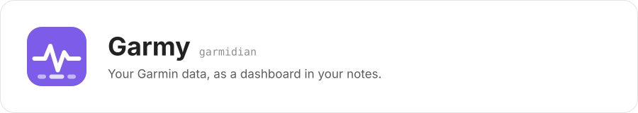
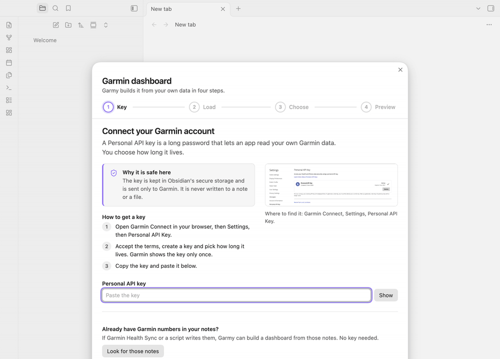
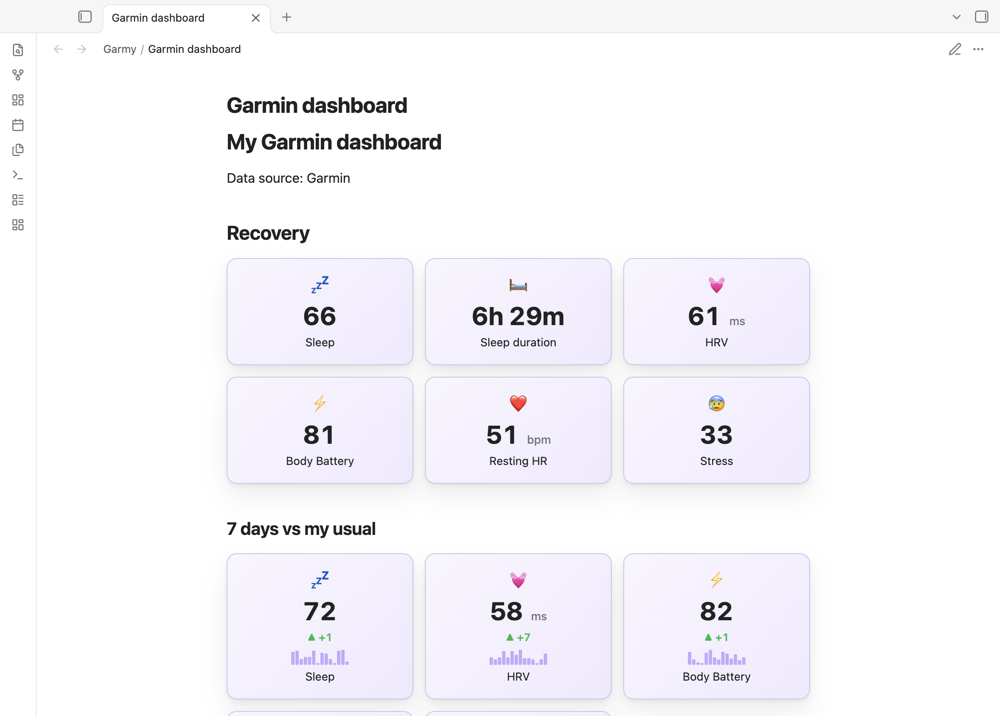
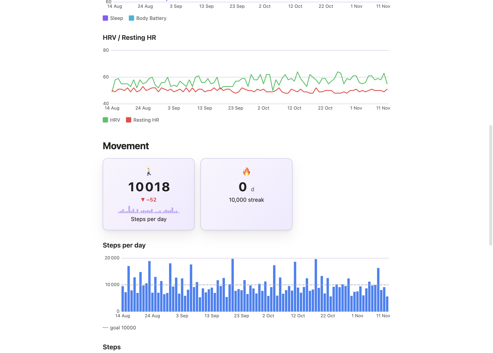
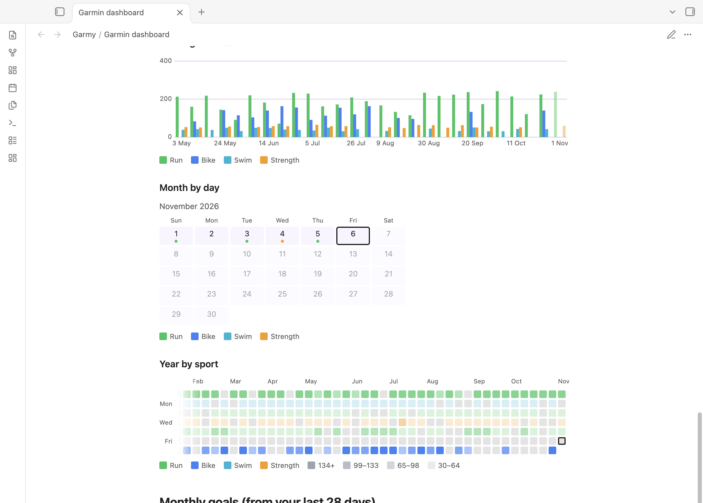
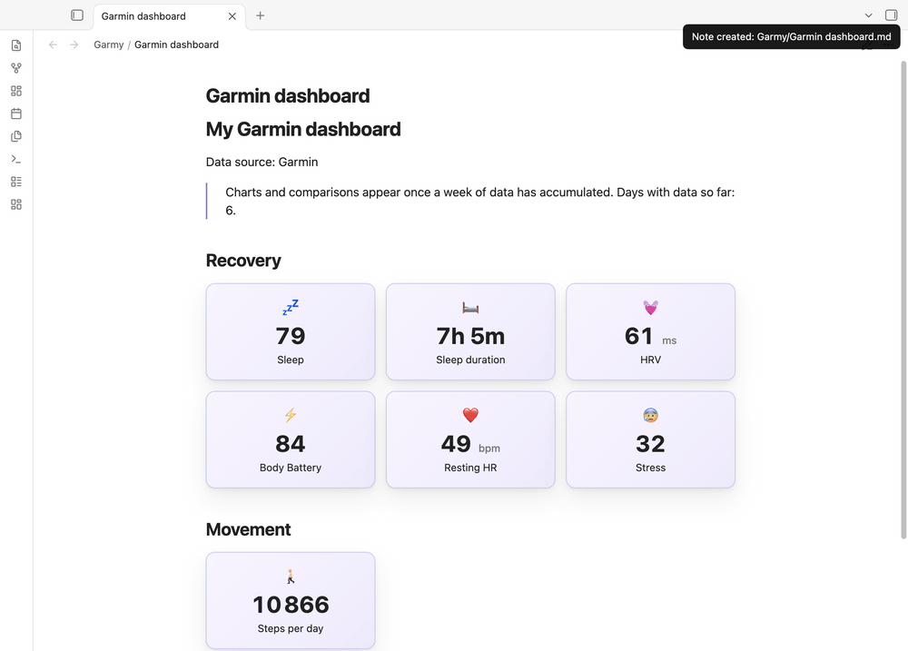
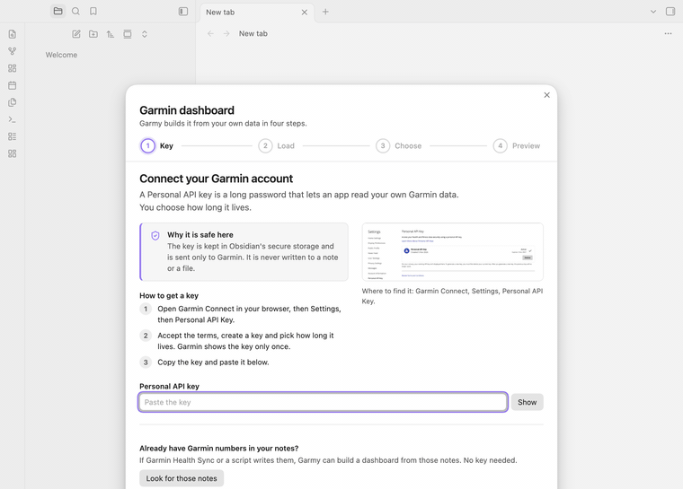

# Garmy

<picture>
  <source media="(prefers-color-scheme: dark)" srcset="https://raw.githubusercontent.com/Dimagious/garmidian/HEAD/docs/banner-dark.svg">
  
</picture>

[](https://github.com/Dimagious/garmidian/blob/main/LICENSE)
[](https://obsidian.md)
[](#seven-languages)
[](https://buymeacoffee.com/dimagious)

**Paste a Garmin key. Pick what you care about. Get a dashboard in your note.**

Sleep, HRV, resting heart rate, Body Battery, steps, runs, rides, swims and strength sessions, drawn as cards, charts and year maps from your own Garmin data. About a minute from install to your first dashboard.



**Install:** Settings, **Community plugins**, **Browse**, search for **Garmy**. Garmy draws its blocks with [Dashy](https://github.com/Dimagious/dashsidian), so install Dashy the same way. Then open the command palette and run **Garmy: Build a Garmin dashboard**.

[Website](https://dimagious.github.io/garmidian/) · [Guides](https://dimagious.github.io/garmidian/guides/) · [Get a Garmin Personal API key](https://dimagious.github.io/garmidian/guides/garmin-personal-api-key/) · [Changelog](https://github.com/Dimagious/garmidian/blob/main/CHANGELOG.md)

## Why you might want it

**You do not have to learn a query language.** Garmy writes the dashboard for you, out of ordinary Dashy blocks in an ordinary note. You can read it, edit it, move it to your home page, or stop using the plugin and keep everything.

**It only shows what you actually have.** No swimming cards if you never swim. No year map after three days of data. Charts and week-over-week comparisons appear once there is enough history to mean something, and monthly goals come from your own last 28 days, not from someone else's numbers.

<picture>
  <source media="(prefers-color-scheme: dark)" srcset="https://raw.githubusercontent.com/Dimagious/garmidian/HEAD/docs/screens/dashboard-1-dark.png">
  
</picture>

**A year of history takes seconds.** Garmy reads Garmin's official Personal API in about 17 requests, saves one plain note per day, and from then on your dashboards work offline.

<p>
  <picture>
    <source media="(prefers-color-scheme: dark)" srcset="https://raw.githubusercontent.com/Dimagious/garmidian/HEAD/docs/screens/dashboard-3-dark.png">
    
  </picture>
  <picture>
    <source media="(prefers-color-scheme: dark)" srcset="https://raw.githubusercontent.com/Dimagious/garmidian/HEAD/docs/screens/dashboard-5-dark.png">
    
  </picture>
</p>

**It stays fresh.** Garmy syncs shortly after Obsidian starts and then every 6, 12 or 24 hours (your choice, or off). The three most recent days are rewritten on every sync, because a day is not finished until it is over.

**It grows with you.** A dashboard built after three days is small. A month later, run **Rebuild the dashboard in this note**: Garmy regenerates only its own part, adds the charts, year maps and goals that were not possible before, picks up a sport you started since, and leaves everything you wrote around it alone.



## Seven languages

The wizard, settings and notices follow Obsidian's language and fall back to English: English, Russian, Spanish, German, French, Portuguese (Brazil) and Japanese. The words inside the dashboard are chosen separately, so you can keep an English interface and a dashboard in your own language.



<sub>Translations other than English and Russian were machine-assisted and are open to correction by native speakers: [open an issue](https://github.com/Dimagious/garmidian/issues).</sub>

## Already keep Garmin numbers in your notes?

If Garmin Health Sync or your own script writes metrics such as `steps` or `sleep_score` into daily notes, the first step of the wizard can find those folders and build the dashboard from them. No key, no loading. Notes need a date in the name (`2026-11-06`, or the format of your daily notes from Daily notes or Periodic Notes, for example `06.11.2026`) and at least two known metrics. Formats with month or weekday names are not read.

## What it writes

One note per day in `Garmy/data`, with these properties when Garmin has them: `steps`, `resting_hr`, `stress`, `sleep_score`, `sleep_duration`, `hrv`, `body_battery` (the day's highest value), and per sport `run_km`, `run_min`, `bike_km`, `bike_min`, `swim_km`, `swim_min`, `strength_min`. Folders are configurable. A dashboard note sits between two comment markers (`%% garmy:start %%` and `%% garmy:end %%`) with its choices in one `garmy` property, which is how the rebuild knows what to do.

## What it does not do

- **No Training Readiness and no VO2 max number.** Garmin's Personal API does not provide them.
- **No full daily distance.** The range endpoints report walking distance only, so Garmy does not write `distance_km` rather than show a wrong number.
- **Not tested on a phone yet.** The plugin is not desktop-only and uses only Obsidian's own APIs, but nobody has run it on an iPhone or Android device, so treat mobile as unverified.
- **Not a coach.** It draws your numbers. It does not interpret them.

## Disclosures

- **Account and key.** You need a Garmin Connect account and a Personal API key you create yourself. Garmin describes the Personal API as meant for individuals who want programmatic access to their own data, and not for commercial applications serving multiple end users. Garmy has no server and no accounts: it runs on your computer with your own key, it is free, and any donation is voluntary. Read the terms you accept when you create a key.
- **Attribution.** Every dashboard names Garmin as its data source right under the title, as Garmin's API brand guidelines ask. Keep that line if you share a screenshot. If Garmin rejects the key (it expires after the lifetime you chose), Garmy says so once and settings offer **Replace key**.
- **Network.** The plugin contacts `personal.connectapi.garmin.com` and nothing else: once to exchange the key for a 24 hour token, then to read your own data. It uses Obsidian's `requestUrl`. There is no telemetry, no analytics and no ads.
- **Your data.** Health data stays in your vault. If your vault is synced (iCloud, git, Obsidian Sync), the daily notes sync with it, like any other note.
- **Secrets.** The key lives in Obsidian's secure storage, never in a note or `data.json`. The token stays in memory.
- **Support.** Garmy is free and nothing is locked behind a payment. If it saves you time, [you can buy me a coffee](https://buymeacoffee.com/dimagious); the plugin itself shows no ads and no donation prompts.
- **Files.** The plugin creates notes in the data folder and the dashboard folder you configure, and changes only the dashboard part of a note you ask it to rebuild. The only time it looks across the whole vault is when you click **Look for those notes**: it reads note properties from Obsidian's cache to find folders that already hold Garmin numbers, opens no file, and keeps nothing.

Garmy is an independent project and is not affiliated with, endorsed by or sponsored by Garmin. Garmin and Garmin Connect are trademarks of Garmin Ltd. or its subsidiaries.

<sub>Every picture and clip above is the real plugin running in real Obsidian, on generated demo data that is nobody's health data (`npm run capture`).</sub>

## Requirements

Obsidian 1.13.0 or newer, the [Dashy](https://github.com/Dimagious/dashsidian) plugin, and a Garmin Personal API key.

## Development

```bash
npm install
npm run lint && npm run typecheck && npm test && npm run build
npm run e2e                       # real Obsidian, fake Garmin (needs macOS Obsidian and a Dashy build, see CLAUDE.md)
GARMIN_LIVE=1 npm run e2e -- e2e/live.spec.ts   # real Garmin, key from the Keychain (service garmin-personal-api)
npm run capture                   # retake the README pictures and clips (needs ffmpeg)
npm run listing                   # rebuild the community directory pictures in docs/listing from the capture
npm run site:check && npm run site:assemble   # the website in site/, deployed to GitHub Pages on a release tag
```

Layers: `src/core` (mapping, data profile, dashboard composer, no I/O), `src/api` (client with injected transport), `src/i18n` (one file per language), `src/app` (wizard, note storage, sync, settings), `src/main.ts`. [Changelog](https://github.com/Dimagious/garmidian/blob/main/CHANGELOG.md).

MIT licensed.
